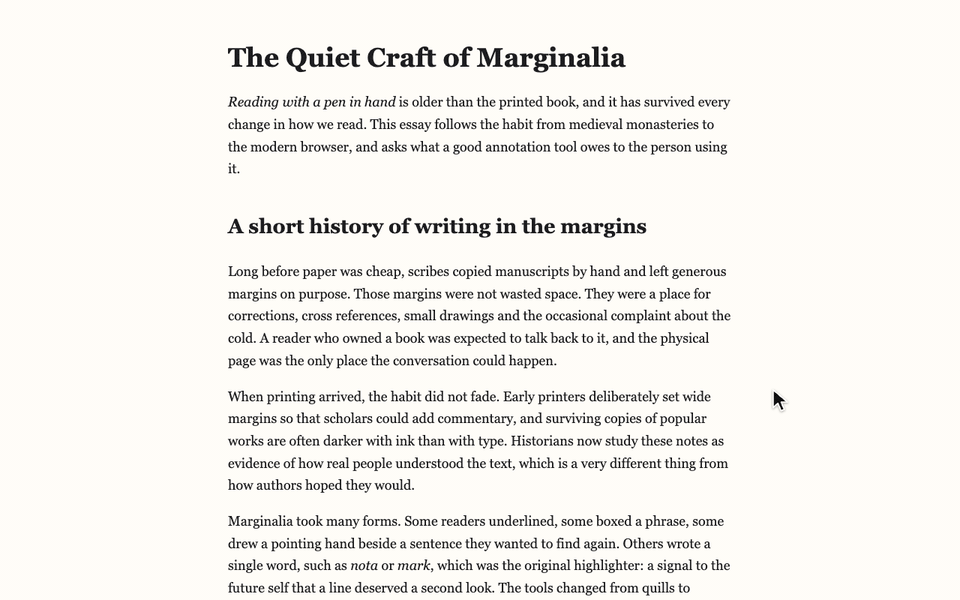
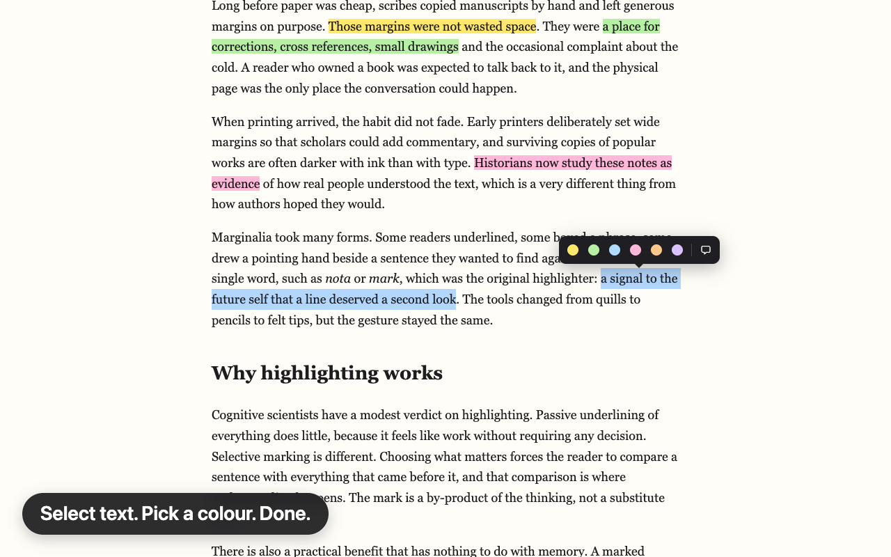
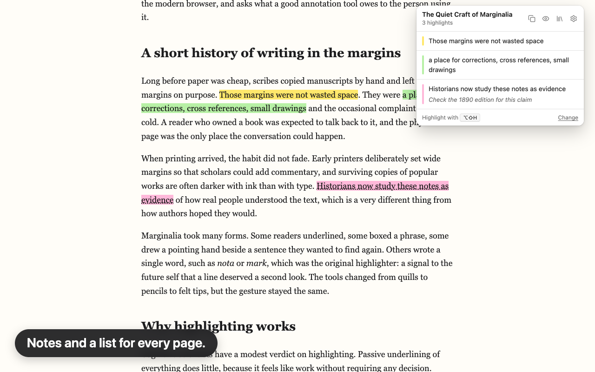
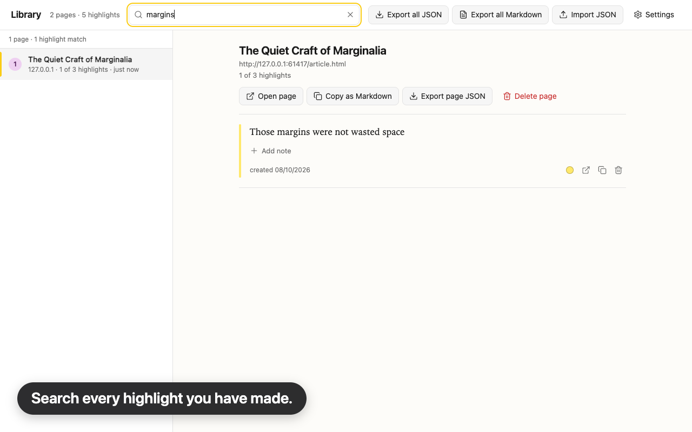

# Hilite: Web Highlighter & Notes

Hilite is a free Chrome extension for highlighting text on web pages (http and https) and finding it again. Select text, pick a colour, done. Your highlights come back when you revisit a page, you can add notes, see each page's highlights in the popup, and search everything you have saved in the library. There is no account, no sign-in and no server: everything stays in your browser.

Chrome Web Store: [Install Hilite](https://chromewebstore.google.com/detail/hilite-web-highlighter-no/aphionhjpmeokfpilaiinlfflnmifjnj)

Website: [codewithbehnam.github.io/hilite](https://codewithbehnam.github.io/hilite/)

*Select, highlight, add a note. The popup lists it.*

## What you get

- One step to highlight: select text and click a colour, or press the shortcut.
- Six colours, changeable after the fact, readable on light and dark sites.
- Highlights come back when you revisit a page, including on single-page apps and pages that load content late. If a page rewrites its text, a highlight may not come back.
- Notes on any highlight.
- A popup listing this page's highlights; click one to jump to it.
- A library of every highlight you have made, with search.
- Export to Markdown or JSON, import JSON back. Undo with Ctrl/Cmd+Z.
- Highlights are painted with the CSS Custom Highlight API, so your text is not wrapped in new elements. Hilite's own toolbar sits in a separate shadow-DOM element.
- Free. No account, no ads, no premium tier, no tracking.

## Who it is for

Anyone who comes back to what they read on the web, and wants persistent highlights, notes, search and export without creating an account.

- Students revisiting study materials: highlights return when you reopen a reading or lecture page, with notes and search for revision.
- Researchers marking important passages: one searchable library across many sources, with Markdown export for your notes app.
- Professionals saving key information from web pages: find the key lines later by search, with no account to sign up for.
- Writers and journalists gathering quotes: Markdown export keeps each page's title and link with its quote.
- Language learners collecting phrases: keep them in context and type a translation into the note.

Hilite works on web pages in desktop Chrome. It has no PDF support, sync between devices, mobile version or sharing.

## How to use it

1. Select text on a web page. A small toolbar appears above it.
2. Click a colour to highlight, or the note button to highlight and add a note straight away.
3. Click a highlight to change its colour, edit its note, copy the text or delete it.
4. Open the popup from the toolbar icon to see this page's highlights, or open the library for everything.

Keyboard shortcuts (Option instead of Alt on macOS; change them at `chrome://extensions/shortcuts`):

| Shortcut | Action |
| --- | --- |
| Alt+Shift+H | Highlight the selection with the last used colour |
| Alt+Shift+V | Show or hide highlights on this page |
| Alt+Shift+K | Open the popup |
| Ctrl/Cmd+Z | Undo the last highlight action |

## Install

From the Chrome Web Store: [Install Hilite](https://chromewebstore.google.com/detail/hilite-web-highlighter-no/aphionhjpmeokfpilaiinlfflnmifjnj).

Manual install of a release build:

1. Download `hilite-<version>.zip` from the [Releases](https://github.com/CodeWithBehnam/hilite/releases) page and unzip it.
2. Open `chrome://extensions`, turn on Developer mode, click "Load unpacked" and choose the unzipped folder.

## Privacy

Hilite stores your highlights, notes, page addresses and settings only in your own browser. It makes no network requests of its own, has no account and no analytics. The full policy is in [PRIVACY.md](PRIVACY.md).

The source code is private, so Hilite is free to use but not open source. This repository holds the privacy policy, screenshots, the website and release downloads.

## Permissions and why

- Storage and unlimited storage: keep your highlights in the browser without a small size cap.
- Context menus: the right-click "Highlight" entry.
- Scripting: start working on tabs that were already open when you installed it.
- Side panel: show the page's highlights beside the page, when you open it (Chrome 116 or later).
- Access to http and https sites: highlights have to be painted on the pages you read. Nothing is sent anywhere.

## Support

Bug reports and feature requests: [issues](https://github.com/CodeWithBehnam/hilite/issues). Please do not include personal information in a public issue.

## Changelog

- 1.1.3 (2026-10-26): toolbar count fixes.
  - Pages that Chrome loads ahead of time no longer change the toolbar count of the page you are reading. Their count shows when you open them.
  - Pages that Chrome shows outside a tab, such as in a side panel, no longer log errors on the extensions page.
- 1.1.2 (2026-10-18): fixes from a launch usability and accessibility review.
  - The Library list can be reached at high browser zoom.
  - Double-clicking Save on a note no longer deletes the highlight, and "Delete all highlights" can no longer be confirmed by a double-click or a held key.
  - After selecting text with the keyboard, Tab goes straight to the colour toolbar.
  - On macOS, shortcuts are written in words, such as Option+Shift+H.
  - Library search ignores accents, so "zoe" finds "Zoë" and "strasse" finds "Straße".
  - Right-to-left quotes and notes, such as Arabic, are laid out correctly.
  - The selected Library tab is readable in Windows High Contrast, and the side panel fits narrow widths.
  - Settings has a link back to the welcome guide, and Export all saves one file per press.
- 1.1.1 (2026-10-17): after Hilite is updated or reloaded, tabs that were already open no longer log errors. Also includes everything from 1.1.0:
  - Highlights are found again after a small edit to the page, such as a fixed typo.
  - An optional side panel (Chrome 116 or later) that lists the page's highlights beside the page.
  - Copy link on each highlight, which opens the page scrolled to the quote.
  - Markers beside the scrollbar (can be turned off), and next and previous highlight shortcuts (assign keys at `chrome://extensions/shortcuts`).
  - While a Hilite panel is open, keys 1 to 6 pick a colour, N adds a note and Delete removes a highlight, with undo.
  - Popup and side panel: search on pages with six or more highlights, copy link, and Pause on this site.
  - Library: an All highlights view, colour filters, sorting, page selection for export or delete, and an export dialog with Markdown styles, JSON backup and CSV.
  - Options: CSV export, colour-blind and high-contrast presets, and an underline option. Highlight colours work in Windows High Contrast.
  - A new `sidePanel` permission, for the side panel.
- 1.0.1 (2026-10-10):
  - A backup reminder with one-click export from the popup.
  - A single, neutral request for a review after real use. You can dismiss it, and it is never repeated.
  - A "Report a site" link that opens a prefilled GitHub issue. You fill in the page address yourself; Hilite never sends it.
  - A "Tell a friend" link.
  - A shorter store summary.
- 1.0.0 (2026-10-08): first release.
